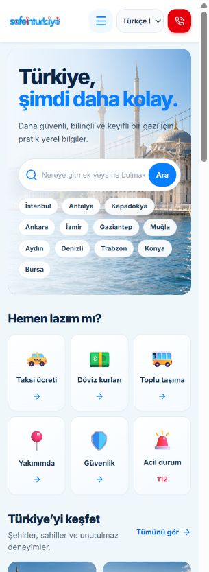

# SafeInTürkiye — Full Platform Audit & Real User Experience Test

**25 Ekim 2026 · Baseline `924674c` · Audit-only**

Canlı: https://www.safeinturkiye.com/  
Önizleme: https://safe-in-turkiye-git-codex-phase3-places-preview-eli-1196.vercel.app/  
Yerel repo: `C:/Users/musta/safe-in-turkiye`.

Bu çalışma sırasında uygulama kodu, production ayarları, API key'ler ve remote veritabanı değiştirilmedi. Gerçek rezervasyon, ödeme veya kullanıcı bildirimi oluşturulmadı. Yalnız bu raporlar ve `audit-evidence/` üretildi. Önceden var olan yerel dosyalar korundu.

İlgili belgeler:

- [Teknik bulgular ve yeniden üretme adımları](SAFEINTURKIYE-AUDIT-FINDINGS.md)
- [7/30/90 günlük yol haritası](SAFEINTURKIYE-IMPROVEMENT-ROADMAP.md)
- [Uygulanan test planı](audit-evidence/TEST-PLAN.md)
- [Komutlar ve gerçek tarayıcı sonuçları](audit-evidence/CHECKS.md)
- [Ham, hassas veri içermeyen HTTP kanıtı](audit-evidence/http-results.json)

## 1. Executive Summary

**Genel değerlendirme: 70/100 — kullanılabilir erken üretim sürümü; henüz “eksiksiz, kurumsal ve tüm cihazlarda sertifikalı” seviyede değil.**

Temel ürün çalışıyor: gerçek taksi rotası/ücret çıktısı, Google Transit alternatifleri, Google yer keşfi, TCMB referans döviz ve Viator ürünleri gerçekten sonuç verdi. Eski katalog artık public listeye/sitemap'e karışmıyor. Şehir düzeyinde back/reload ve alt URL'ye doğrudan giriş önceki şikâyete göre doğru çalışıyor.

Ancak “her şey tamam” demek doğru olmaz. **14 bulgu** kaydedildi: P0 **0**, P1 **2**, P2 **10**, P3 **2**. P1'lerin biri gerçek destek/işletmeci eksikliği; diğeri **Windows geliştirme ortamındaki** Vite güvenlik patch'i. Canlıda kritik veri sızıntısı veya genel hizmet kesintisi gösterilmedi. Bu bir penetration test veya hukuki uygunluk sertifikası değildir.

En önemli ürün eksikleri: eksik ortak UI çevirileri, manuel bölgenin yenilemede unutulması, işlevsiz sezonsal kısayollar, login erişilebilirliği, tarife bakım politikası ve operasyonel güven unsurları. Safe AI ve Hotel Booking API bilinçli olarak ertelenmiş; **bug veya bu sürümün kapanış şartı sayılmadı**.

## 2. Genel ürün değerlendirmesi

İlk izlenim anlaşılır: “Türkiye, made easier” mesajı; taksi, döviz, ulaşım ve Near Me öne çıkıyor. Ana sayfa 320px'de bile ana işlevlere ulaşılabilir durumda. Şehir görsellerinin AI kaynaklı olduğu alt metin/credit ile belirtiliyor; gerçek işletme fotoğrafı gibi sunulmuyor. Google fotoğrafları ve source/author atıfları işletme sonuçlarında mevcut.

Ürünün güçlü tarafı **Türkiye'ye özgü pratik araçları tek yerde toplaması**. Google Maps'in kapsamıyla veya Viator'ın booking altyapısıyla yarışmak yerine, turistin “Şimdi ne yapmalıyım?” sorusunu sadeleştirmesi daha değerli.

Tekrar kullanım gerekçesi: turist gün içinde taksi bütçesi, ulaşım alternatifi, para dönüşümü, eczane/işletme bulma ve güvenlik bilgisine aynı siteden dönebilir. Zayıf nokta: keşif sonuçları büyük ölçüde dış sağlayıcılardan geliyor; bölgeyi hatırlama ve yerel pratik bilginin güncelliği yeterince güçlü değilse kullanıcı doğrudan Google Maps'e geçebilir. Öncelik daha çok API değil, daha az tekrar giriş ve daha güvenilir bağlam olmalı.

## 3. Test edilen ortamlar ve mimari

| Katman | Mevcut yapı / doğrulama |
|---|---|
| Frontend | React 19, TypeScript, Vite 8.2.2, Tailwind; custom browser-history navigation; lazy route components |
| Hosting | Vercel static/prerender pages + `/api` serverless; canonical www host; main/preview ayrımı |
| Veri | Statik şehir rehberleri + Google discovery + Viator tours; Supabase auth/CMS/tariffs/Foundation hazırlığı |
| Auth | Supabase session + profiles role; public admin gate; RLS migration dosyaları ve izole PostgreSQL regression |
| SEO | Build-time şehir/section HTML ve sitemap; runtime meta güncelleme; 27 public sitemap URL |
| Yerel | Full tests/typecheck/lint/build; mevcut localhost Vite `/api` yapısının tamamını taklit etmez |
| Production browser | Gerçek in-app Chromium; canlı arama/rota/ürün sonuçları |
| Preview | Mevcut Antalya keşif sayfası reload ve yapı tutarlılığı spot-check; tam ikinci kabul testi değil |

Provider / credential envanteri (**değerler okunmadı/yazılmadı**):

| İşlev | Gerçek provider / endpoint | Konfigürasyon isimleri |
|---|---|---|
| Places / discovery | Google Places New `places:searchNearby`, exchange için `places:searchText` | Sunucu `GOOGLE_PLACES_API_KEY` |
| Fotoğraf | Sunucu imzalı `/api/place-photo` -> Places media -> Google image redirect | Aynı sunucu key; 15dk imza |
| Adres önerisi | Photon, Türkiye scope | Public endpoint; özel key yok |
| Taxi rota | Public OSRM driving; reverse Nominatim | Public servisler; private key yok |
| Taxi harita | Google Maps Embed, hesaplama rotasından bağımsız | Kısıtlanması gereken public browser key |
| Transit | Google Routes `directions/v2:computeRoutes` TRANSIT; Google JS polyline map | `GOOGLE_TRANSIT_API_KEY`, `TRANSIT_ALLOWED_ORIGINS`, `VITE_GOOGLE_TRANSIT_MAP_KEY` |
| Döviz | `/api/reference-rates` -> Frankfurter v2 **TCMB provider**, EUR bazlı 7 quote | Yeni key yok |
| Hava | `/api/weather` -> MET Norway Locationforecast | Public provider; model tarihi/CC BY credit |
| Tours | Viator partner v2 destinations + products/search; outbound affiliate booking | `VIATOR_API_KEY`, `VIATOR_ENVIRONMENT` sunucuda |
| CMS/hesap | Supabase | Public URL/anon key, Foundation flag; server events için service role server-side |

## 4. Kapsam ve sınırlar

Gerçek route envanteri: `/`, `/taxi`, `/transport`, `/exchange`, `/near-me`, `/hotels`, `/restaurants`, `/activities`, `/tours`, `/safety`, `/guides`, `/privacy`, `/terms`, `/about`, `/contact` ve **12 şehir route'u**. Anonymous `/#admin` ayrıca denendi. Şehirler: İstanbul, Antalya, Cappadocia, Ankara, İzmir, Gaziantep, Muğla, Aydın, Denizli, Trabzon, Konya, Bursa.

Saved/Profile için bağımsız public route envanterde yok; varmış gibi test edilmiş veya bozuk denmedi. Authenticated CMS detayları gelecekte yayınlanabilir; emekliye ayrılan 91 slug için yönlendirme/filtreleme var.

**Sınırlar:** gerçek iPhone/Android, Safari/WebKit/Firefox, OS klavyesi/rotasyon ve başarılı gerçek GPS yok. Konum alınamama akışı görüldü; gerçek permission-denied prompt ile karıştırılmadı. Offline/throttle ve provider timeout/zero/quota senaryoları gerçek browser network simülasyonuyla değil, mevcut automated fixtures ile kontrol edildi. Yetkili admin hesabıyla yazma ve production RLS introspection yapılmadı. Bütün şehir × dil × kategori × ekran kombinasyonları tüketilmedi. Örneklem ile full matrix certification farklıdır.

## 5. Önemli bulgular / öncelik

| Sıra | Bulgu | Etki / gereken işlem |
|---|---|---|
| 1 | F01 gerçek destek/işletmeci eksik | Sahip gerçek iletişim ve sorumluluğu belirlemeli |
| 2 | F02 Windows Vite advisory | Kontrollü patch; production exploit kanıtı değil |
| 3 | F03 UI çeviri boşlukları | DE/FR/AR/RU/ZH ortak metinleri tamamla |
| 4 | F04 manuel bölge restore edilmiyor | Güvenli session/query restorasyonu |
| 5 | F05 Summer/Winter yanlış vaat | Çalışmayan kısayolu kaldır/yeniden adlandır |
| 6 | F06 login modalı erişilebilir değil | Etiket, focus, Escape ve dialog semantiği |
| 7 | F14 uzun oturumda fotoğraf kaybı | Token/reference yenileme ve görünür retry |
| 8 | F07 budget fare bakım politikası yok | Review tarihi/eskime politikası; rakam uydurma yok |
| 9 | F08 JS/logo ağırlığı | Küçük, ölçülü performans düzeltmeleri |
| 10 | F09 CSP/framing eksik | Preview report-only ile kontrollü hardening |

F10 asset doğrulama script'i bağımlılık hatası; F11 durmuş rezervasyonla FAQ/legal çelişkisi; F12 negatif döviz tutarında mesaj eksikliği; F13 Safety tekrarları da kayıtlı. Her biri için adımlar, beklenen/gerçek sonuç, kök neden, kanıt ve maliyet [bulgu kaydında](SAFEINTURKIYE-AUDIT-FINDINGS.md).

## 6. P0/P1/P2/P3 dağılımı

**0 / 2 / 10 / 2**. İzole testler ve pasif incelemede P0 gözlenmedi. P1 support operasyonu ve development güvenliği birbirinden ayrılmalı. WAF/Cloud quota, remote RLS ve CMS publish/rebuild gibi kanıtlanmamış durumlar ayrı risk/erişim sınırı; fotoğraf eskimesi R03'ten kanıtlı F14'e taşındı.

## 7. Mobil ve masaüstü

Ana sayfa **320, 375, 390, 430, 768, 1024, 1440px** genişliklerinde root yatay taşma göstermedi. 12 şehir sayfasında 390px root taşması görülmedi. Transit gerçek sonuçları 320/390/768'de DOM ölçümüyle kontrol edildi. Header/mobile menu ve şehir araç butonları kullanılabilir.

Ancak küçük ikincil düğmeler ve login modalının focus davranışı iyileştirilmeli. Mobil klavye, gerçek Safari geri gesture'ı, iOS safe-area ve telefon döndürme sertifikalandırılmadı. Mevcut Chromium back/reload testi geçti; bunun tüm iOS sorunlarını çözdüğünü söylemek doğru değil.

## 8. Özellik bazlı sonuçlar

| Alan | Gerçek test / sonuç | Kalan sınır |
|---|---|---|
| Home | Empty search çökmedi; menu, city/guide links; 7 genişlik | Mevsim kısayolu filtrelemiyor; unknown search için daha açıklayıcı UX fırsatı |
| City | 12 rehber doğru H1 ve ortak tasarım; Gaziantep -> hotels city aktarımı; Bursa Çince/forecast | Her noktanın saha güncelliği denetlenmedi; bazı “don't miss” blokları sadece isim |
| Taxi | Taksim–Sultanahmet: 5.6 km, ~9dk, yaklaşık TRY340; source details ve Google embed var | Tek gerçek yolculuk örneği, 12 şehrin her tarifesi resmî kaynakla yeniden audit edilmedi; OSRM ≠ Google rota |
| Transit | İstanbul 4 alternatif, otobüs+tramvay+walk, provider fare/map; Ankara 4 alternatif; 8 dil | Her şehir/hat için Google coverage garantisi yok; no-fare/timeout fixtures üzerinden |
| Near Me | Aydın gerçek Google sonuçları; manuel Beşiktaş; konum alınamama recovery | Denied ve granted gerçek GPS yok; manuel bölge refresh kaybı |
| Restaurants | Antalya 15 result, 6 initial cards; gerçek 7 Mehmet detail/photo/address/phone/hours/website; back/reload | Gerçek restoran araması/rezervasyon yok; tek fotoğraf mevcut; uzun oturumda yeni kart görselleri kaybolabiliyor (F14) |
| Hotels | Gaziantep Google otelleri gerçek; şehir aktarımı doğru | Oda fiyatı/müsaitlik/booking bu ürünün açık özelliği değil; API eksikliği bug sayılmadı |
| Activities | İstanbul 20 Google result; kategori kontrolü ve fotoğraflar | Mevsim shortcuts anlamsız; bütün türlerin tüm şehirlerde kapsandığı iddia edilmez |
| Tours | Çince UI içinde 12 Viator ürün; tracked outbound links | Gerçek satın alma/commission settlement test edilmedi; UI filters + automated mapping test, her canlı kombinasyon değil |
| Currency | TCMB/Frankfurter 23 Ekim yayını; 100EUR≈5565.42TL; Aydın 2 bureau | Büro buy/sell fiyatı yok ve açıkça belirtiliyor; invalid input message eksik |
| Weather | Bursa tahmin/model tarihi/CC BY kaynağı göründü | Model hava ölçüm istasyonu veya canlı trafik değil |
| Safety / FAQ | 112, kaynaklar, pratik açıklamalar, 20 FAQ detail | Safety tekrarları, kapalı rezervasyona ilişkin eski anlatım |
| Legal / About | Sayfalar açılıyor ve dil değişiyor | Contact/işletmeci eksik; gerçek veri akışına göre tamamlama gerekli |
| Auth / CMS | Anonymous admin içeriği gösterilmedi; modal incelendi; local RLS isolation test geçti | Gerçek admin yazısı, login/restore ve applied prod policies doğrulanmadı |

Taxi formülü: `max(minimum, opening + actual_route_km × per_km)`. Bir özel budget örneğinde kademeli km var. Kodda +15%, trafik/hava veya araç sınıfı için keyfî çarpan yok. Gösterilen harita ayrı Google rotası seçtiğini açıklıyor. Kaynaklı gözlemsel budget ile verified CMS tariff aynı kalite garantisi değil; F07 bunun bakım riskidir.

Viator'da `pid`/`mcid`/`medium`/`api_version` parametreleri korunmuş ve CTA `rel=sponsored` kullanıyor. Çincedeki İngilizce ürün içeriği için fallback açıklaması mevcut. Bu, her rezervasyonun kesin komisyon kazanacağı veya hesapta komisyonun kaydedildiği anlamına gelmez.

## 9. Güvenlik ve gizlilik

Olumlu: server-side Places/Routes/Viator proxy; sabit allowlist URL'leri; input validation ve timeouts; fotoğraf token imzaları; no-store Google responses; URL/telefon sanitizer; React text rendering; HSTS/nosniff; admin fail-closed; yerel RLS/ownership/role escalation regression. Browser Maps key'leri doğası gereği görünürdür; Cloud restriction durumları yeniden okunmadı. Secret/key değerleri rapora veya evidence'e kopyalanmadı.

Eksikler: F02 dev patch, F06 modal, F09 CSP, F01/F11 gerçek gizlilik/iletişim içeriği. Google ve analitik isteklerinin zamanı/amaçları sahip tarafından yazılı politikalara doğru yansıtılmalı. Cookie consent gerekip gerekmediği yönünde ülke bazlı hukuk hükmü verilmedi.

Kodun local rate limits'leri **dağıtık/global harcama garantisi değildir**. Mevcut WAF veya Google provider kotası yok denmedi; hesabın bugünkü ayarları görülmedi. Yük/abuse testi yapılmadı.

Google atıfları mevcut; fakat tam uyumluluk sertifikalandırılmadı. Google logosu mümkün olan yerde tercih edilmeli, text attribution'ın stil/görünürlük kuralları ayrıca eşleştirilmeli; fotoğraf kaynaklarını saklama/yenileme biçimi sağlayıcı kurallarına göre kalmalı. [Google Places politikaları](https://developers.google.com/maps/documentation/places/web-service/policies).

## 10. SEO ve performans

**Doğrulanan:** 27/27 sitemap URL HTTP200; kendi canonical'ları doğru; apex->www tek 308; unknown route HTTP404/noindex; retired hotel link doğru 308; favicon/96px PNG/manifest 200 ve build icon kontrolleri başarılı. robots `/api/` erişimini crawl'dan engelliyor, homepage/icons engellenmiyor. 12 şehir HTML'i JS öncesi ad/açıklama sunuyor; section HTML'leri daha kısa progressive fallbacks.

Şu an sitemap'te ayrı locale URL'leri yok; EN/TR eski emekli detay URL'leri aramaya yönleniyor. UI dil tercihi ile indexlenebilir locale route aynı şey değil. Ayrı çevrilmiş SEO sayfası yok diye yanlış hreflang üretmemek doğru. Google Search indeks durumu veya favicon güncellenme zamanı Search Console olmadan iddia edilmedi.

**Build ölçümü:** 633.80kB main JS / gzip205.86; 541.74kB logo; 50.11kB CSS / gzip10.42. Uyarı var, build hatası değil. Bazı route komponentleri lazy. Responsive şehir WebP'leri, width/height, lazy decoding mevcut. Yeni gerçek görsel paketi eklenmedi.

**Ölçülmeyen:** LCP/INP/CLS ve Lighthouse skoru. Lighthouse kurulu değil; bu tarayıcı kontrolünün read-only DOM scope'u Performance API sağlamıyor. HTTP komut sürelerini Core Web Vitals yerine kullanmadık. Bu alan sonraki kontrollü ölçüm işi; performans “100/100” denemez.

## 11. API ve altyapı maliyetleri

Bu tur hesap faturası veya kalan ücretsiz kredi okunmadı. **“Ek ücret yok / kredi şu kadar” sonucu çıkarılamaz.** Gerçek browser aramaları normal provider çağrıları üretti; load test yapılmadı.

| Alan | Koddan görülen maliyet etkeni | Düşük maliyetli önlem |
|---|---|---|
| Places | Her şehir/dil/kategori değişimi yeni arama; telefon/rating/hours alanları Enterprise SKU tetikler | İstekleri debounce/abort; arama gereksizse tetikleme; field mask'i ihtiyaca göre değerlendirme |
| Photos | Lazy img var ama her yeni fotoğraf endpoint'i provider çağrısı; 15dk token | On-demand yükleme; kullanıcı açıkça yenileyebilsin; yasak persistent cache ekleme |
| Routes | Kullanıcı Find routes ile; benzer sorgu kısa süre memory reuse | Daha önceki başarılı sorguyu kontrollü tekrar kullan, tahminî trafik üretme |
| Viator | Manual search ve pagination; taxonomy kısa süre sunucu belleğinde | Geçersiz filtreyi upstream öncesi engelle; gereksiz auto-search ekleme |
| Vercel | Serverless invocation + data transfer + asset JS | Logo/chunk küçültme ve abuse quota gözden geçirme |
| Supabase | Auth/CMS/event çağrıları; admin query'leri | Sorgu/page limit, indeks ve retention gerçek hacme göre; yeni plan önerisi yok |
| Rates/weather | Kısa shared/public cache; referans yayın tarihi | Mevcut kısa cache'i koru, aynı sayfada tekrar fetch üretme |

Google ücretlendirmesi istenen alanların en yüksek SKU'suna bağlıdır. Buradaki telefon/hours/rating alanları maliyet bakımından ücretsizmiş gibi anlatılmamalı. [Resmî Nearby Search field-mask açıklaması](https://developers.google.com/maps/documentation/places/web-service/nearby-search), [usage/billing](https://developers.google.com/maps/documentation/places/web-service/usage-and-billing).

## 12. Rakip ve sektör karşılaştırması

Bu bir tüm rakiplerde aynı checkout'ı gerçekleştirme testi değil; 25 Ekim'de erişilen **resmî public ürün sayfaları** üzerinden karşılaştırma. Trafik, conversion ve kalite puanları uydurulmadı.

| Referans | Gözlenen standart | Bizim için ucuz uygulanabilir karşılığı |
|---|---|---|
| [Google Maps](https://www.google.com/maps/about/) | Keşif, navigasyon ve kaydedilebilir bağlam | Son seçilen bölgeyi güvenli hatırla; amaç başka Maps klonu yapmak değil |
| [Tripadvisor](https://www.tripadvisor.com/) | Hedef/ilgi alanından keşfe açık giriş | Tekrarlanan category CTA'larını sadeleştir; source/rating bilgisini okunur tut |
| [GetYourGuide](https://www.getyourguide.com/) | Places to see / things to do / inspiration ayrımı | Gezilecek yer ile satın alınabilir tur ayrımını koru; çalışmayan mevsim shortcut'ını kaldır |
| [Viator](https://www.viator.com/) | Destinasyon ve tur türü odaklı discovery | Takipli CTA ve provider checkout'ını koru; fiyat/müsaitliği garanti gibi gösterme |
| [Rome2Rio](https://www.rome2rio.com/) | A'dan B'ye ulaşım sorusu merkezde | Transit sonucunu seçilen rota/transfer/süre üzerinden anlaşılır tut; uydurma kapsam sözü verme |
| [GoTürkiye](https://goturkiye.com/) | Destinasyon hikâyesi ve yerel içerik | Gerçek güncel ulaşım/ziyaret ipuçları; fotoğraftan çok pratik bağlamla farklılaş |

## 13. En değerli 10 iyileştirme

1. Gerçek destek kanalı ve işletmeci bilgisi — güven; düşük kod maliyeti, sahip kararı.
2. Windows toolchain güvenlik patch'i — geliştirme güvenliği; düşük maliyet.
3. Ortak metin çeviri matrisi — anlamlı sekiz dil deneyimi; orta emek, yeni API yok.
4. Manuel bölge restore — daha az yeniden giriş; orta emek, privacy-aware.
5. Mevsim kısayollarını dürüstleştir — hemen daha doğru beklenti; düşük emek.
6. Login accessibility ve hata metinleri — klavye ve yabancı ziyaretçi için; düşük-orta.
7. Tarife bakım checklist'i — yanlış güveni azaltır; az kod + sürekli kaynak kontrolü.
8. Logo ve ölçülü JS optimizasyonu — mobil maliyet/hız; düşük-orta.
9. Süresi dolan fotoğraf referansı için kontrollü yenileme — uzun oturumda görsellerin korunması; orta, yeni API gerekmez.
10. CSP preview/report-only + provider quota kontrolü ve CI gate — güvenlik/maliyet/regression; orta, yeni paid ürün şart değil.

## 14. Kaldırılabilecek/sadeleştirilebilecek en fazla 5 unsur

- Gerçek ayrı filtre üretmeyen Summer/Winter kısa yolları (F05).
- Safety altındaki tekrarlanan Safety guide/aynı tavsiyeler (F13).
- Kapalı rezervasyon hizmeti için hâlâ aktif süreç izlenimi veren FAQ metinleri (F11).
- Genel ziyaretçiye değer sağlamayan CMS login açıklaması: staff erişimini koruyarak footer girişini daha amaca uygun sunmak (F03/F06).
- Çok uzun tekrar eden açıklamaları gerektiğinde disclosure içinde toplamak; **kaynak, konum veri paylaşımı, sponsor/affiliate ve güvenlik açıklamalarını gizleyerek ortadan kaldırmamak**.

Attribution veya gerekli disclosure'lar gereksiz yazı değildir. Çalışan Taxi/Exchange/Transit/Google/Viator'ı kaldırma veya baştan tasarlama önerilmiyor.

## 15. Önceliklendirilmiş plan ve yaklaşık maliyet

[Yol haritası](SAFEINTURKIYE-IMPROVEMENT-ROADMAP.md) acceptance criteria içerir. İlk düzeltme grubu F02 + F03 + F04 + F05 + F06 + F10 + F11 + F14; F01 için sahip bilgisi beklenir. Ardından tarife bakım süreci, CSP, logo ve validation polish.

Bu, satın alma teklifi değildir: mevcut geliştiriciyle ilk kod grubu yaklaşık **3–6 geliştirici günü**, provider/device/admin doğrulama ve kontrollü release dahil **5–9 gün** planlama aralığı; sahip yanıtı/dil review zamanına bağlı. Yeni zorunlu API/abonelik **önerilmiyor**. Mevcut kullanım maliyetleri ve olası domain e-posta/hukuk hizmeti ayrıdır. Freelancer € bedeli saat ücreti bilinmeden uydurulmadı.

## 16. Yayına hazır olma kararı

**Çalışan discovery/travel-tool sürümü olarak kullanılabilir; agresif reklam/kurumsal güven ve kapsamlı cihaz garantisi için hazır değil.** Bu audit, mevcut yayını kapatma veya yeni deploy yapma kararı vermedi. Destek/mahremiyet bilgileri tamamlanmadan rezervasyon operasyonu açılmamalı. Windows development patch'i önceliklendirilmeli; production data/credentials değiştirmek bunun şartı değil.

384 test önemli bir güvence ancak bütün tarayıcıları, gerçek API kapsamasını ve operasyonu kanıtlamıyor. “Hatasız” yerine **kanıtlanan akışlar çalışıyor, kayıtlı eksikler ve erişim sınırları var** sonucu doğru.

## 17. Puanın gerekçesi

| Boyut | Puan | Gerekçe |
|---|---|---|
| Temel araç ve veri doğruluğu | 26/30 | Gerçek canlı rota/arama/kurlar/ürünler; tarife bakımı ve provider kapsam sınırı |
| UX / mobil / dil | 16/25 | Responsive yapı ve city routing iyi; bölge restorasyonu, çeviri, modal ve eski oturum fotoğrafları eksik |
| Güven / işletme hazırlığı | 10/20 | Kaynak/affiliate/fiyat açıklamaları var; gerçek destek, operatör ve legal veri akışı tamam değil |
| Teknik güvenlik / test disiplini | 12/15 | 384 test, RLS izolasyonu, proxy/validation; dev patch ve CSP eksiği |
| SEO / performans | 6/10 | Gerçek 200/404/canonical/assets iyi; bundle/logo ve ölçülmemiş CWV |
| **Toplam** | **70/100** | Mühendislik değerlendirmesi; Lighthouse veya bağımsız sertifika skoru değil |

**Durum: AUDIT COMPLETE WITH EXPLICIT COVERAGE LIMITATIONS — IMPLEMENTATION APPROVAL PENDING.** Uygulama, deployment ve remote migration yapılmadan burada durulmuştur.
